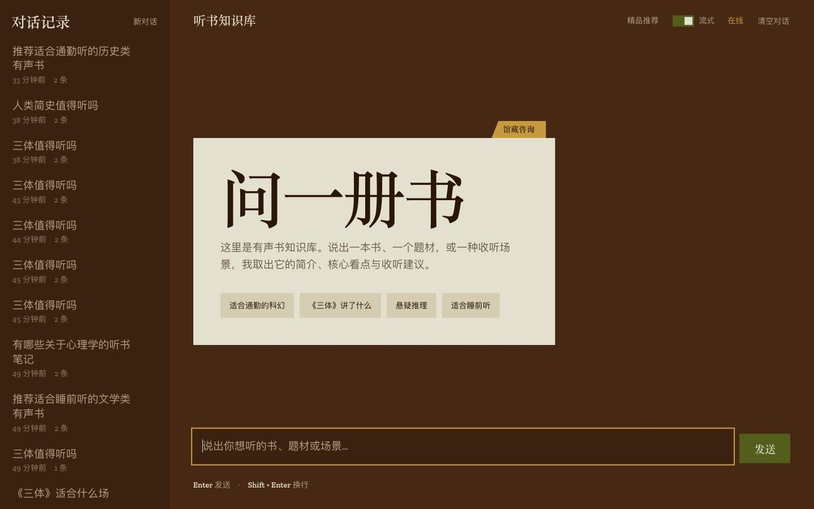
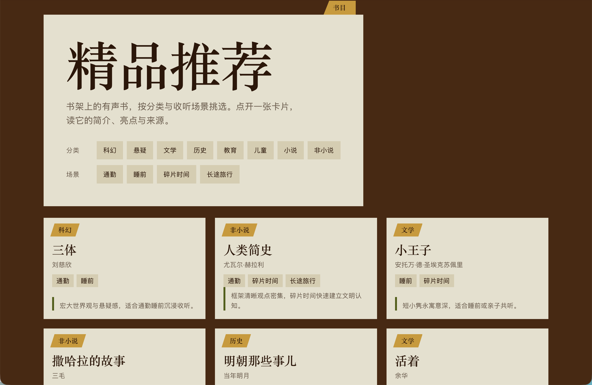
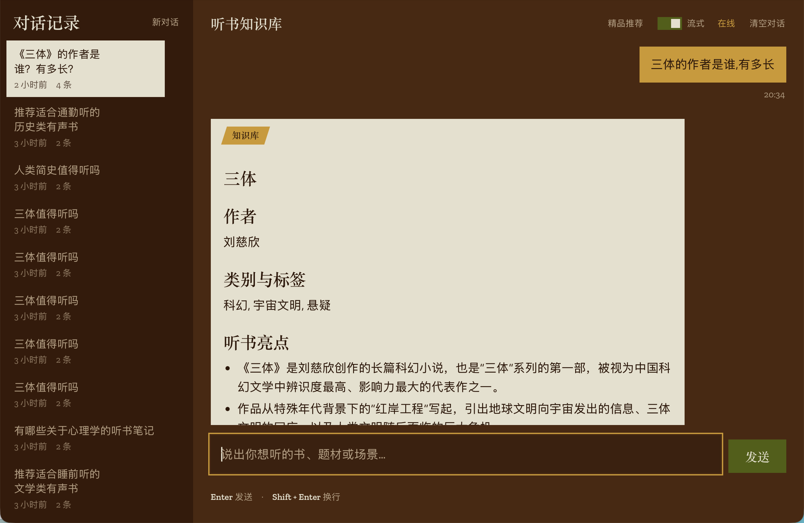
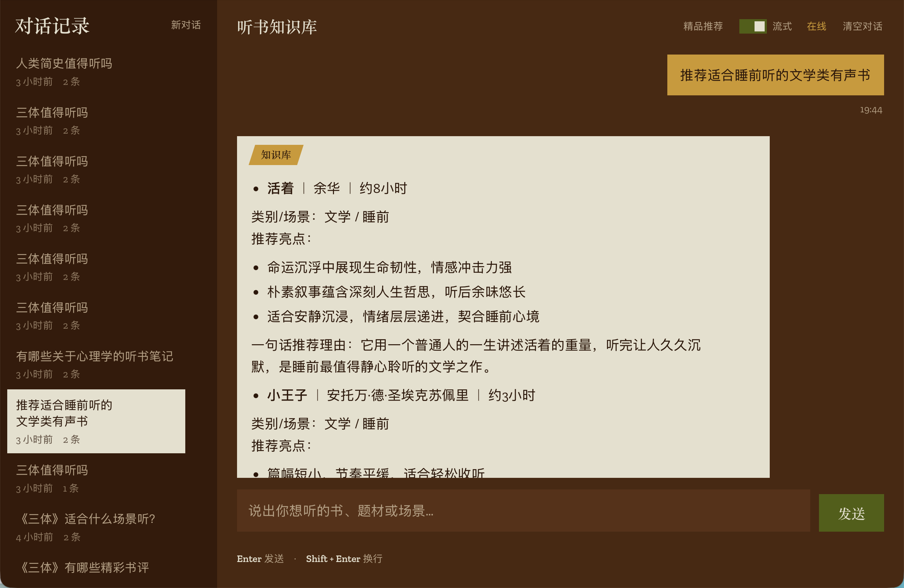
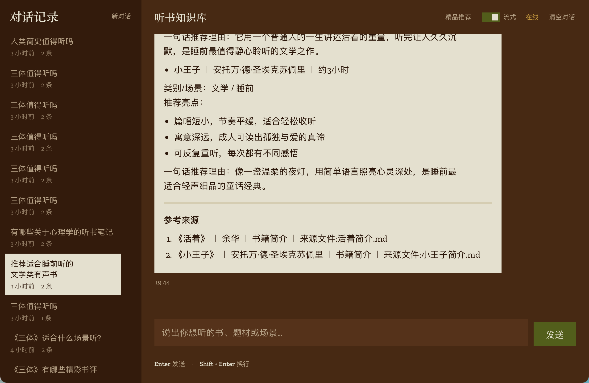
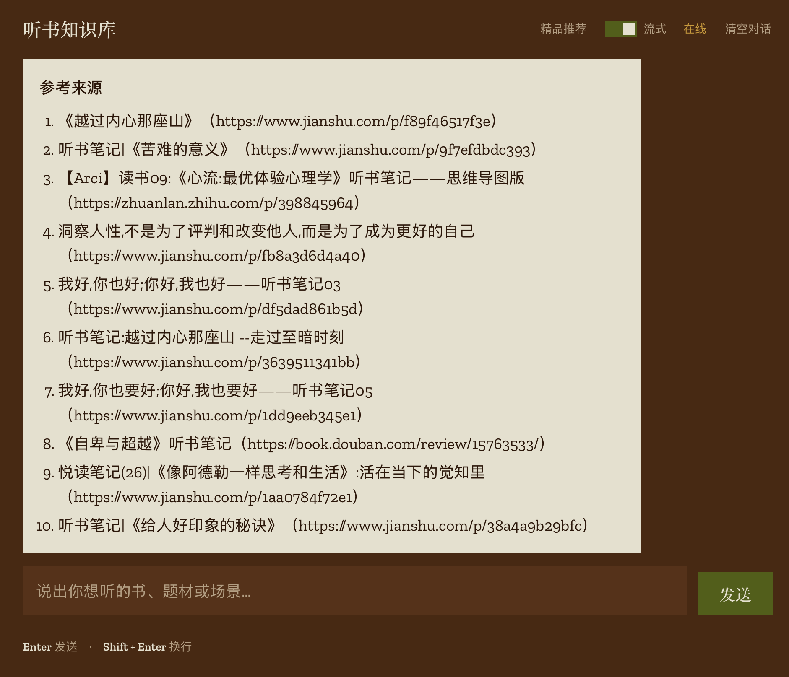
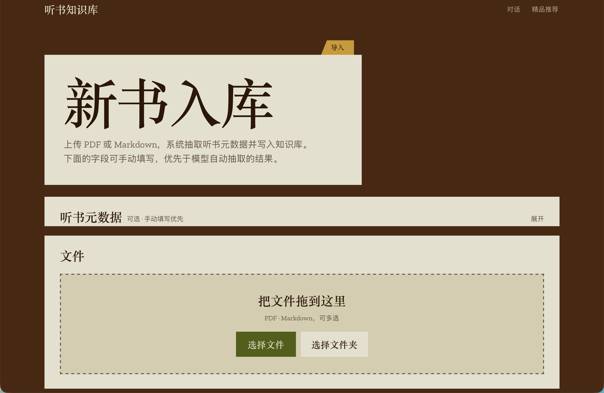

# AI 知识库 (AI Knowledge Base)

这是一个基于 RAG 技术的智能知识库系统，支持文档导入、智能问答、混合搜索等功能。项目采用 FastAPI 构建 RESTful API，结合 Milvus 向量数据库、LLM 大语言模型等组件实现高效的知识检索与问答。

## 界面预览
主页

推荐

聊天




导入


### 项目架构

```mermaid
flowchart TD

subgraph group_api["HTTP API"]
  node_import_api["导入 API<br/>[import_server.py]"]
  node_query_api["查询 API<br/>[query_server.py]"]
end

subgraph group_import["文档导入"]
  node_import_flow["导入工作流<br/>[main_graph.py]"]
  node_import_state["导入状态<br/>[state.py]"]
  node_pdf_parse["PDF 解析"]
  node_markdown_images["Markdown 图片<br/>[node_md_img.py]"]
  node_document_split["文档切分<br/>[split_service.py]"]
  node_item_recognition["条目识别"]
  node_embedding_import["分块向量化"]
  node_indexing["向量索引<br/>[index_service.py]"]
end

subgraph group_query["问答"]
  node_query_flow["查询工作流<br/>[main_graph.py]"]
  node_query_state["查询状态<br/>[state.py]"]
  node_embedding_search["混合检索"]
  node_hyde_search["HyDE 检索"]
  node_web_search["MCP 网络搜索"]
  node_item_confirm["条目确认"]
  node_rrf["RRF 融合<br/>[rrf_service.py]"]
  node_rerank["重排序<br/>[rerank_service.py]"]
  node_answer["答案生成<br/>[answer_service.py]"]
  node_book_features["图书发现<br/>[query_server.py]"]
end

subgraph group_infra["模型与存储"]
  node_llm_provider["LLM 提供方<br/>[providers.py]"]
  node_milvus[("Milvus 网关<br/>[milvus_gateway.py]")]
  node_minio[("MinIO 网关<br/>[minio_gateway.py]")]
  node_history_api[("历史记录仓储")]
  node_mongo[("Mongo 历史客户端")]
  node_infra_config["基础设施配置<br/>[providers.py]"]
end

subgraph group_shared["共享运行时"]
  node_task_tracking["任务跟踪<br/>[task_utils.py]"]
  node_sse["SSE 工具<br/>[sse_utils.py]"]
  node_config["共享配置<br/>[common.py]"]
  node_prompt_loader["提示词加载器<br/>[load_prompt.py]"]
end

node_user(("用户"))
node_user_external["网络搜索服务"]

node_user -->|"上传文件"| node_import_api
node_import_api -->|"启动导入"| node_import_flow
node_import_flow -->|"解析 PDF"| node_pdf_parse
node_import_flow -->|"处理图片"| node_markdown_images
node_import_flow -->|"切分文档"| node_document_split
node_import_flow -->|"识别名称"| node_item_recognition
node_import_flow -->|"向量化分块"| node_embedding_import
node_import_flow -->|"索引分块"| node_indexing
node_embedding_import -->|"生成向量"| node_llm_provider
node_embedding_search -->|"向量化查询"| node_llm_provider
node_embedding_search -->|"混合检索"| node_milvus
node_hyde_search -->|"生成 HyDE"| node_llm_provider
node_hyde_search -->|"混合检索"| node_milvus
node_hyde_search -->|"加载提示词"| node_prompt_loader
node_item_recognition -->|"调用 LLM"| node_llm_provider
node_item_recognition -->|"校验名称"| node_milvus
node_user -->|"提问"| node_query_api
node_query_api -->|"运行查询"| node_query_flow
node_query_flow -->|"分发检索"| node_embedding_search
node_query_flow -->|"分发 HyDE"| node_hyde_search
node_query_flow -->|"分发网络搜索"| node_web_search
node_query_flow -->|"分发确认"| node_item_confirm
node_query_flow -->|"分发融合"| node_rrf
node_query_flow -->|"分发重排序"| node_rerank
node_query_flow -->|"分发答案生成"| node_answer
node_web_search -.->|"搜索网络"| node_user_external
node_answer -->|"生成回复"| node_llm_provider
node_answer -->|"存储消息"| node_history_api
node_query_api -->|"读取历史"| node_history_api
node_history_api -->|"委托持久化"| node_mongo
node_query_api -->|"跟踪任务"| node_task_tracking
node_task_tracking -->|"推送进度"| node_sse
node_import_api -->|"跟踪导入"| node_task_tracking
node_query_api -->|"流式事件"| node_sse
node_llm_provider -->|"读取设置"| node_infra_config
node_milvus -->|"读取设置"| node_infra_config
node_embedding_import -->|"更新状态"| node_import_state
node_embedding_search -->|"读取状态"| node_query_state
node_hyde_search -->|"读取状态"| node_query_state
node_infra_config -->|"装配设置"| node_config
node_user -->|"请求发现"| node_book_features
node_book_features -.->|"图书查询流程"| node_query_flow

click node_import_api "https://github.com/lrj021029/ai-knowledge-base/blob/main/app/api/http/import_server.py"
click node_query_api "https://github.com/lrj021029/ai-knowledge-base/blob/main/app/api/http/query_server.py"
click node_import_flow "https://github.com/lrj021029/ai-knowledge-base/blob/main/app/process/import_/agent/main_graph.py"
click node_import_state "https://github.com/lrj021029/ai-knowledge-base/blob/main/app/process/import_/agent/state.py"
click node_pdf_parse "https://github.com/lrj021029/ai-knowledge-base/blob/main/app/rag/import_/pdf_parse_service.py"
click node_markdown_images "https://github.com/lrj021029/ai-knowledge-base/blob/main/app/process/import_/agent/nodes/node_md_img.py"
click node_document_split "https://github.com/lrj021029/ai-knowledge-base/blob/main/app/rag/import_/split_service.py"
click node_item_recognition "https://github.com/lrj021029/ai-knowledge-base/blob/main/app/rag/import_/item_name_service.py"
click node_embedding_import "https://github.com/lrj021029/ai-knowledge-base/blob/main/app/rag/import_/embedding_service.py"
click node_indexing "https://github.com/lrj021029/ai-knowledge-base/blob/main/app/rag/import_/index_service.py"
click node_query_flow "https://github.com/lrj021029/ai-knowledge-base/blob/main/app/process/query/agent/main_graph.py"
click node_query_state "https://github.com/lrj021029/ai-knowledge-base/blob/main/app/process/query/agent/state.py"
click node_embedding_search "https://github.com/lrj021029/ai-knowledge-base/blob/main/app/rag/query/embedding_search_service.py"
click node_hyde_search "https://github.com/lrj021029/ai-knowledge-base/blob/main/app/rag/query/hyde_search_service.py"
click node_web_search "https://github.com/lrj021029/ai-knowledge-base/blob/main/app/rag/query/web_search_service.py"
click node_item_confirm "https://github.com/lrj021029/ai-knowledge-base/blob/main/app/rag/query/item_name_confirm_service.py"
click node_rrf "https://github.com/lrj021029/ai-knowledge-base/blob/main/app/rag/query/rrf_service.py"
click node_rerank "https://github.com/lrj021029/ai-knowledge-base/blob/main/app/rag/query/rerank_service.py"
click node_answer "https://github.com/lrj021029/ai-knowledge-base/blob/main/app/rag/query/answer_service.py"
click node_book_features "https://github.com/lrj021029/ai-knowledge-base/blob/main/app/api/http/query_server.py"
click node_llm_provider "https://github.com/lrj021029/ai-knowledge-base/blob/main/app/infra/llm/providers.py"
click node_milvus "https://github.com/lrj021029/ai-knowledge-base/blob/main/app/infra/vectorstore/milvus_gateway.py"
click node_minio "https://github.com/lrj021029/ai-knowledge-base/blob/main/app/infra/object_storage/minio_gateway.py"
click node_history_api "https://github.com/lrj021029/ai-knowledge-base/blob/main/app/infra/persistence/history_repository.py"
click node_mongo "https://github.com/lrj021029/ai-knowledge-base/blob/main/app/shared/clients/mongo_history_utils.py"
click node_infra_config "https://github.com/lrj021029/ai-knowledge-base/blob/main/app/infra/config/providers.py"
click node_task_tracking "https://github.com/lrj021029/ai-knowledge-base/blob/main/app/shared/utils/task_utils.py"
click node_sse "https://github.com/lrj021029/ai-knowledge-base/blob/main/app/shared/utils/sse_utils.py"
click node_config "https://github.com/lrj021029/ai-knowledge-base/blob/main/app/shared/config/common.py"
click node_prompt_loader "https://github.com/lrj021029/ai-knowledge-base/blob/main/app/shared/runtime/load_prompt.py"

classDef toneNeutral fill:#f8fafc,stroke:#334155,stroke-width:1.5px,color:#0f172a
classDef toneBlue fill:#dbeafe,stroke:#2563eb,stroke-width:1.5px,color:#172554
classDef toneAmber fill:#fef3c7,stroke:#d97706,stroke-width:1.5px,color:#78350f
classDef toneMint fill:#dcfce7,stroke:#16a34a,stroke-width:1.5px,color:#14532d
classDef toneRose fill:#ffe4e6,stroke:#e11d48,stroke-width:1.5px,color:#881337
classDef toneIndigo fill:#e0e7ff,stroke:#4f46e5,stroke-width:1.5px,color:#312e81
classDef toneTeal fill:#ccfbf1,stroke:#0f766e,stroke-width:1.5px,color:#134e4a
class node_import_api,node_query_api,node_user toneBlue
class node_import_flow,node_import_state,node_pdf_parse,node_markdown_images,node_document_split,node_item_recognition,node_embedding_import,node_indexing toneAmber
class node_query_flow,node_query_state,node_embedding_search,node_hyde_search,node_web_search,node_item_confirm,node_rrf,node_rerank,node_answer,node_book_features toneMint
class node_llm_provider,node_milvus,node_minio,node_history_api,node_mongo,node_infra_config toneRose
class node_task_tracking,node_sse,node_config,node_prompt_loader,node_user_external toneIndigo
```


### 文档导入
- **PDF 转 Markdown**：支持将 PDF 文档转换为 Markdown 格式
- **文档智能分块**：基于标题和内容进行智能文档分割
- **BGE 向量嵌入**：使用 BGE-M3 模型生成文档块向量
- **商品名称识别**：通过 LLM 自动识别文档中的商品名称
- **Markdown 图片增强**：自动处理 Markdown 中的图片并上传至对象存储

### 智能问答
- **混合搜索**：支持向量搜索与关键词搜索的混合检索
- **HyDE 搜索**：使用 HyDE (Hypothetical Document Embeddings) 技术提升搜索效果
- **Web 搜索**：集成 MCP Web 搜索能力
- **Rerank 重排序**：使用重排序模型对检索结果进行优化
- **RRF 融合**：通过倒数排名融合 (Reciprocal Rank Fusion) 合并多路搜索结果
- **对话历史管理**：支持多会话对话历史存储与管理

### 技术架构
- **后端框架**：FastAPI
- **向量数据库**：Milvus
- **对象存储**：MinIO
- **大语言模型**：支持多种 LLM 提供商
- **嵌入模型**：BGE-M3
- **重排序模型**：FlagReranker

## 项目结构

```
ai_0812_knowledge_base/
├── app/
│   ├── api/                  # API 接口层
│   │   ├── http/             # HTTP 接口
│   │   │   ├── import_server.py    # 文档导入接口
│   │   │   └── query_server.py     # 问答接口
│   │   └── schema/           # 数据模型
│   ├── infra/                # 基础设施层
│   │   ├── config/           # 配置管理
│   │   ├── llm/              # LLM 提供商
│   │   ├── object_storage/   # 对象存储网关
│   │   ├── persistence/      # 持久化层
│   │   └── vectorstore/      # 向量数据库网关
│   ├── process/              # 业务流程
│   │   ├── import_/          # 导入流程
│   │   │   └── agent/        # 导入 Agent 图
│   │   └── query/            # 查询流程
│   │       └── agent/        # 查询 Agent 图
│   ├── rag/                  # RAG 核心服务
│   │   ├── import_/          # 导入相关服务
│   │   └── query/            # 查询相关服务
│   ├── shared/               # 共享模块
│   │   ├── clients/          # 客户端工具
│   │   ├── config/           # 配置定义
│   │   ├── model/            # 模型工具
│   │   ├── runtime/          # 运行时工具
│   │   └── utils/            # 工具函数
│   └── resources/
│       ├── html/             # 前端页面
│       └── prompts/          # 提示词模板
├── fast_api/                 # 扩展 API 模块
├── test/                     # 测试代码
└── main.py                   # 应用入口
```

## 快速开始

### 环境要求

- Python 3.10+
- Milvus 向量数据库
- MinIO 对象存储
- MongoDB (用于对话历史存储)

### 安装依赖

uv sync

### 配置环境变量

复制 `.env.example` 文件并配置相关参数：

```bash
cp .env.example .env
```

主要配置项：
- LLM API 配置
- Milvus 连接配置
- MinIO 连接配置
- MongoDB 连接配置
- Embedding 模型配置

### 启动服务

```bash
python main.py
```

服务启动后，可访问：
- API 文档：`http://localhost:8000/docs`
- 导入界面：`http://localhost:8000/html/import`
- 问答界面：`http://localhost:8000/html/chat`

## API 接口

### 文档导入

| 接口 | 方法 | 描述 |
|------|------|------|
| `/upload` | POST | 上传文档文件 |
| `/status/{task_id}` | GET | 获取导入任务状态 |

### 智能问答

| 接口 | 方法 | 描述 |
|------|------|------|
| `/query` | POST | 提交问答请求 |
| `/stream/{session_id}` | GET | 流式获取回答 |
| `/history/sessions` | GET | 历史会话清单（按最后一条消息倒序，含首条提问作为标题） |
| `/history/{session_id}` | GET | 获取单个会话的对话历史（最近 50 条） |
| `/history/{session_id}` | DELETE | 清空对话历史 |
| `/health` | GET | 健康检查 |

## 开发指南

### 添加新的导入节点

在 `app/process/import_/agent/nodes/` 目录下创建新的节点文件：


### 添加新的查询服务

在 `app/rag/query/` 目录下创建新的服务文件，并在查询图 `main_graph.py` 中注册。

## 技术栈

- **Web Framework**: FastAPI
- **Vector Database**: Milvus
- **Object Storage**: MinIO
- **LLM**: OpenAI Compatible APIs
- **Embedding**: BGE-M3
- **Reranker**: FlagReranker
- **Graph Workflow**: LangGraph

